# Agent Log Studio

**把任何视频做成 Agent 思维链，让每个动作都有一份足够专业的运行日志。**

猫伸爪，是末端执行器完成目标接触；人发呆，是推理引擎正在扩大搜索空间；连续选错，是探索策略主动采集负样本；吃口零食，是奖励信号开始胃部反向传播。只要日志写得够严肃，万物皆可具身智能。

Agent Log Studio 是本机运行的视频与日志工作台：上传视频，为它编写观察、推理、决策、执行与奖励日志，在网页里同步预览，再直接导出带原声的完整成片。支持 CSV 导入、逐条编辑、双语排版与阶段字幕。你负责提供视频和剧本，它负责把胡说八道排版得像刚通过了论文评审。

从 [启动](#启动) 开始，按 [网页完整流程](#网页完整流程) 制作自己的视频；也可以直接载入下面的猫咪或螃蟹示例，从第一根萝卜、第一朵浪花开始部署智能。

## 界面设计

Web 工作台与视频成片按 [Geist 官方设计规范](https://vercel.com/geist/introduction)统一排版：Geist Sans / Mono 字体、黑白灰层级、细边框和一致的按钮、表单、标签与弹窗。设计变量集中在 `src/theme.js`；预览与导出等待本地字体加载后，共用同一套视频渲染器。

工作台与成片统一使用 Geist 深色主题。成片顶部左侧为标题，右侧为独立 ASCII 字标，不占用日志区域。默认字标定义在 `src/config.js`，可通过「日志 → 头部 TUI 图案」替换，通过「画布 → 头部 TUI Logo」开关；完整成片与纯日志分别保存 Logo 配置。深色日志面板显示已出现的事件数，阶段标题与说明上下排列。横屏、竖屏和方形采用对应的布局比例；已有日志、自定义配色和素材配置继续保留。编辑面板支持方向键移动焦点、Enter / Space 切换页签，弹窗支持 Esc 关闭。

## 猫咪 VLA 示例视频

让“大开门”听口令辨识萝卜和纸巾，再配上一本正经的 VLA 运行日志。完整成片为 45.6 秒，保留原视频的人类口令和猫咪动作，用 Geist 深色排版同步呈现视频、日志与阶段字幕，顶部左侧为标题、右侧为 ASCII 字标。

下面是成片前 8.2 秒的动图：猫先碰纸巾，重发“萝卜”指令后纠正目标，随后获得奖励。

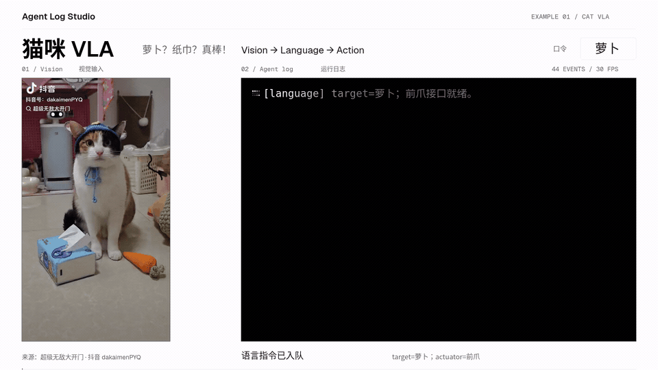

日志示例：

```text
[policy] 回滚纸巾分支；橙色长条提升为主目标。
[reward] 收到真棒与食物；奖励梯度进入胃部。
[action] 切换纸巾目标；前爪提交热修复。
```

<details>
<summary>查看成片高清截图</summary>

纸巾识别与前爪执行：


最后一轮目标纠正与“前爪热修复”：

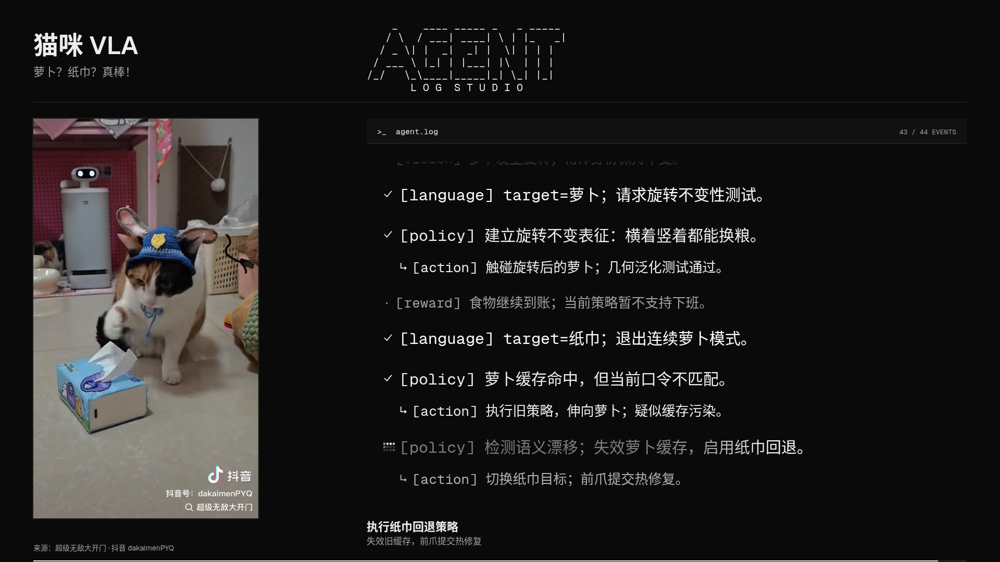

</details>

启动网页后，打开「视频合成」，点击「载入猫咪完整示例」。素材、[44 条双语日志](public/samples/cat-vla.csv)、Geist 版式和 25 段阶段字幕会一起载入。可以直接播放、修改文案或时间，再点击「导出完整视频」下载带原声的 MP4，全程在网页操作。

首次载入猫咪示例需要联网下载固定版本素材并校验 SHA-256，下载使用系统 `curl`。环境需要 Chrome / Chromium 和中文字体；FFmpeg 由依赖自带。

<details>
<summary>命令行复现（可选，网页可完成全部制作步骤）</summary>

按下方「启动」步骤安装依赖并运行 `npm run dev`，再在另一个终端执行：

```sh
npm run example:cat-vla
```

[示例脚本](scripts/make-cat-vla.mjs) 与网页调用同一套素材处理、共享预览渲染和合成导出接口；完整成片输出到 `output/examples/cat-vla/cat-vla.mp4`，规格为 1920 × 1080、30 fps、H.264 / AAC。

</details>

README 展示用的截图和短动图均已更新为深色版本，保存在 `docs/images/`；原素材及完整生成产物保留在忽略的 `output/` 目录。素材作者为抖音「超级无敌大开门」（`dakaimenPYQ`），原水印和音轨均保留。更多来源与复现步骤见 [猫咪 VLA 示例说明](docs/猫咪VLA示例.md)。

## 螃蟹 VLA 示例视频

一只真实海滩上的岸蟹，先横向移动、停顿转向，再随浪花抵达进入浅水。19.2 秒的连续镜头保留正常速度与环境原声，配上 23 条双语日志和 11 段阶段字幕：八腿负责导航，海浪负责全量推送。

下面是成片第 4.5–12.5 秒：浪花进入视野、第一股海水抵达，“沙盒环境”开始升级为“水池”。

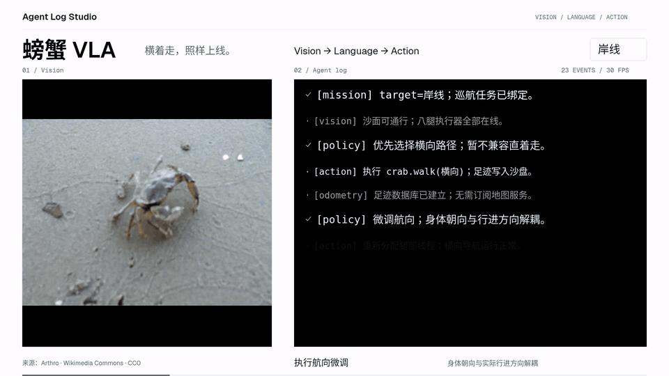

```text
[policy] 优先选择横向路径；暂不兼容直着走。
[environment] 首批海水抵达；沙盒升级为水池。
[policy] 干燥任务稍后重试；海浪接口没有拒绝按钮。
```

在「视频合成」点击「载入螃蟹完整示例」，即可一并载入视频、[双语日志](public/samples/crab-vla.csv)、字幕与版式，再直接编辑、预览和导出。

[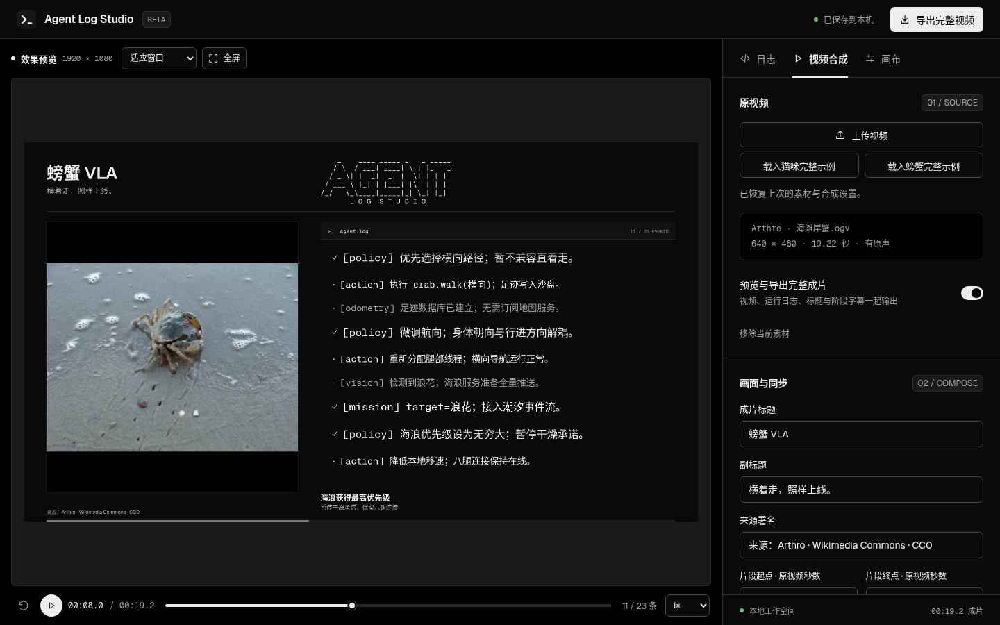](docs/images/crab-vla-workbench.png)

<details>
<summary>查看成片高清截图与命令行复现</summary>

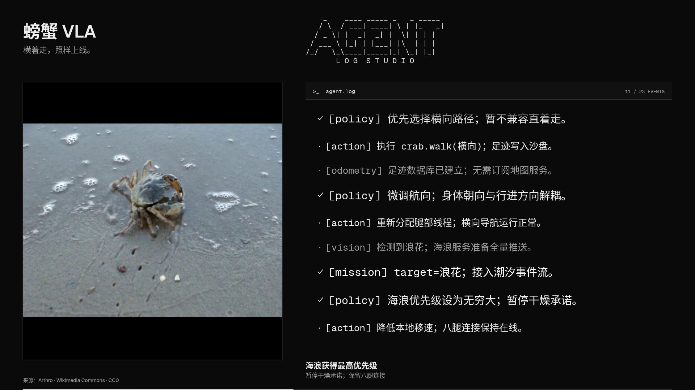

服务启动后，在另一个终端执行：

```sh
npm run example:crab-vla
```

完整成片输出到 `output/examples/crab-vla/crab-vla.mp4`，规格为 1920 × 1080、30 fps、H.264 / AAC。网页与命令行使用同一份预设和导出接口。

</details>

素材来自 [Arthro / Wikimedia Commons](https://commons.wikimedia.org/wiki/File:Carcinus_maenas_walking_on_land.ogv)，许可为 [CC0 1.0](https://creativecommons.org/publicdomain/zero/1.0/)，成片保留署名。首次载入从 `upload.wikimedia.org` 下载并校验原素材。动作时间线、来源与复现步骤见 [螃蟹 VLA 示例说明](docs/螃蟹VLA示例.md)。

## 启动

需要 Node.js 20.19+ 或 22.12+，视频导出还需要 Google Chrome / Chromium。FFmpeg 由依赖自带；含中文的成片需要系统安装中文字体。

```sh
npm ci
npm run dev
```

访问 <http://127.0.0.1:4320>，macOS 也可以双击 `启动 Agent Log Studio.command`。首次使用或切换平台时先运行 `npm ci`。

默认只监听本机。用 `PORT` 更改端口，Chrome 不在常见路径时设置 `CHROME_PATH`。草稿保存在当前浏览器、当前站点的本地存储中，键名为 `agent-log-studio-v1`。

生产模式：

```sh
npm run build
npm start
```

## 网页完整流程

启动服务并打开网页后，素材上传、日志编辑、字幕同步、预览和完整成片导出都可以在网页完成。下面以猫咪 VLA 为例，截图均来自当前实际运行的深色 Web UI，包含统一的 Agent Log Studio 品牌标识；点击图片可以查看原图。

### 1. 载入原视频

打开右侧「视频合成」，点击「上传视频」使用自己的素材，或点击「载入猫咪完整示例」「载入螃蟹完整示例」一次载入相应的视频、双语日志、阶段字幕和版式。猫咪示例含 44 条日志、25 段字幕；螃蟹示例含 23 条日志、11 段字幕。单个素材最多 200 MB、20 分钟，准备完成后确认「预览与导出完整成片」已开启。

[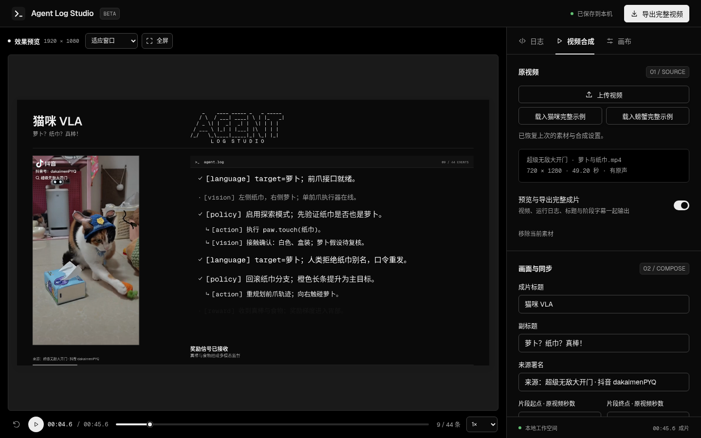](docs/images/web-workbench.png)

### 2. 编写运行日志

切到「日志」，可以导入 CSV、添加日志，或点击已有条目打开编辑窗口。填写出现时间、上屏时间戳、类型与中英文文案，点击「保存日志」。猫咪完整示例已配好日志，改两句就能给前爪升级推理引擎。多场景 CSV 支持切换，每次预览和导出一个场景。

[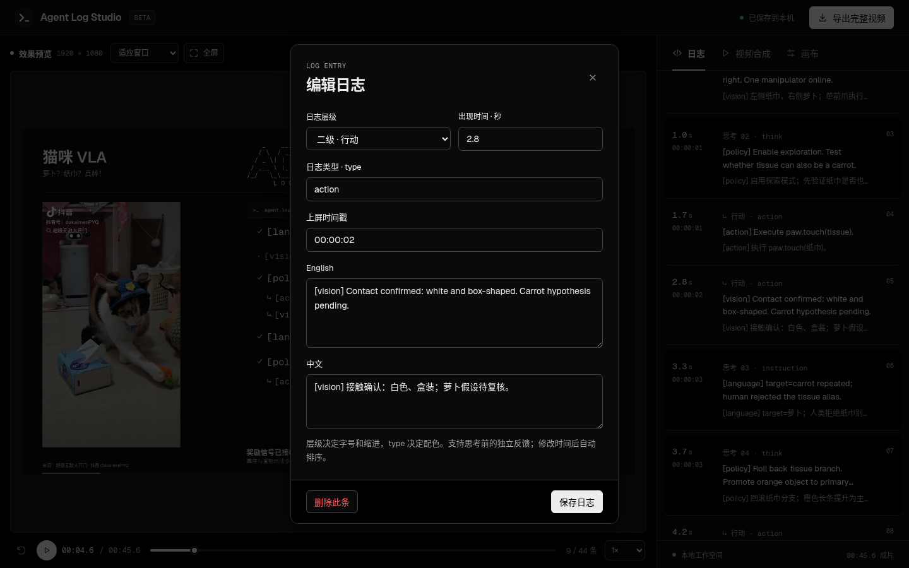](docs/images/web-log-editor.png)

### 3. 设置画面与同步

回到「视频合成」，向下滚动到「画面与同步」，编辑标题、副标题、来源署名、片段起止时间与日志延迟，选择完整画面或居中裁切、是否保留原声及日志黑白排版。

[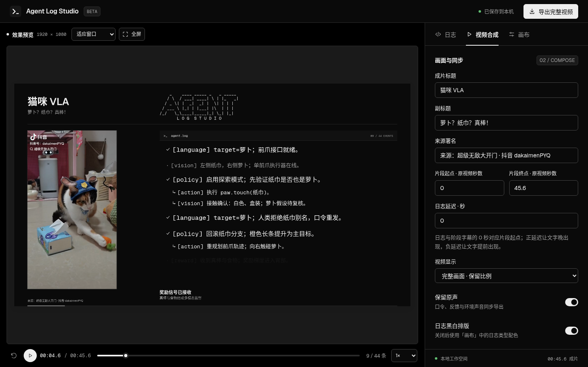](docs/images/web-composition-settings.png)

继续向下到「阶段字幕」，点击「添加」或已有条目，编辑出现时间、标题和说明，再点击「保存字幕」。阶段字幕显示在成片底部，用来交代当前目标与执行阶段。

[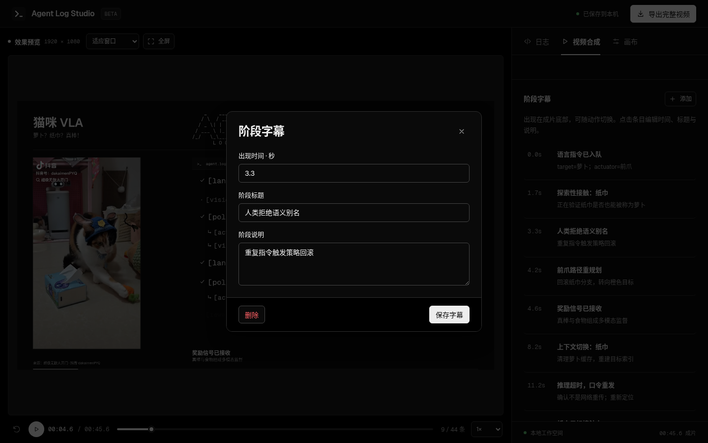](docs/images/web-phase-editor.png)

日志与阶段字幕的 0 秒对应所选片段的起点，二者共用「日志延迟」：正数让文字晚出现，负数让文字提前出现。例如选取原视频 10–20 秒，日志的出现时间设为 2 秒、延迟设为 1 秒，这条日志会在原视频第 13 秒出现；使用 1× 播放倍率时，对应导出成片的第 3 秒。播放倍率同时作用于视频、原声和文字。

### 4. 调整版式并预览

在「画布」调整尺寸、双语、字号、配色、发光、Logo、播放倍率和折叠；关闭「日志黑白排版」后使用自定义类型配色。横屏左右排版，竖屏和方形画布上下排版。用左侧下方的播放按钮与时间轴核对原视频、日志和阶段字幕，也可以放大或全屏查看。

[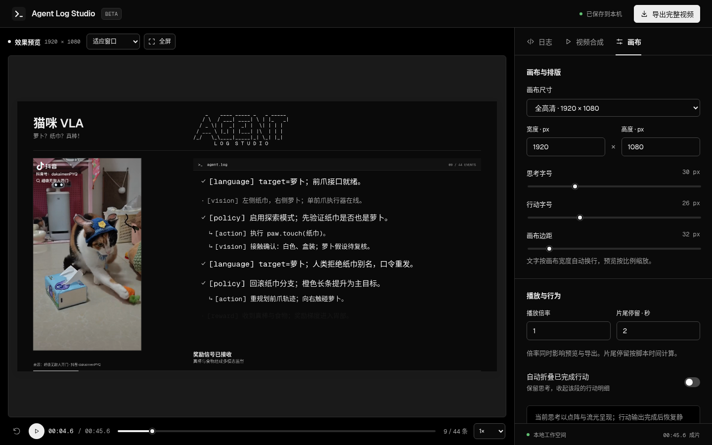](docs/images/web-canvas-preview.png)

“压缩长等待”用于纯日志素材；完整成片按原视频时间同步，可直接编辑每条日志的出现时间。纯色、图片和棋盘格背景只影响纯日志预览；完整成片使用 Geist 深色外框。

### 5. 导出并下载成片

点击右上角「导出完整视频」，选择 24 / 30 / 60 fps，以及整个视频片段或从当前时刻起最多 5 秒的样片，再点击「开始导出」。完成后点击「下载视频」保存 MP4，过程中可以查看进度或取消。下图展示实际导出完成的 5 秒样片；制作整段视频时，把「导出范围」改为「完整视频片段」。

[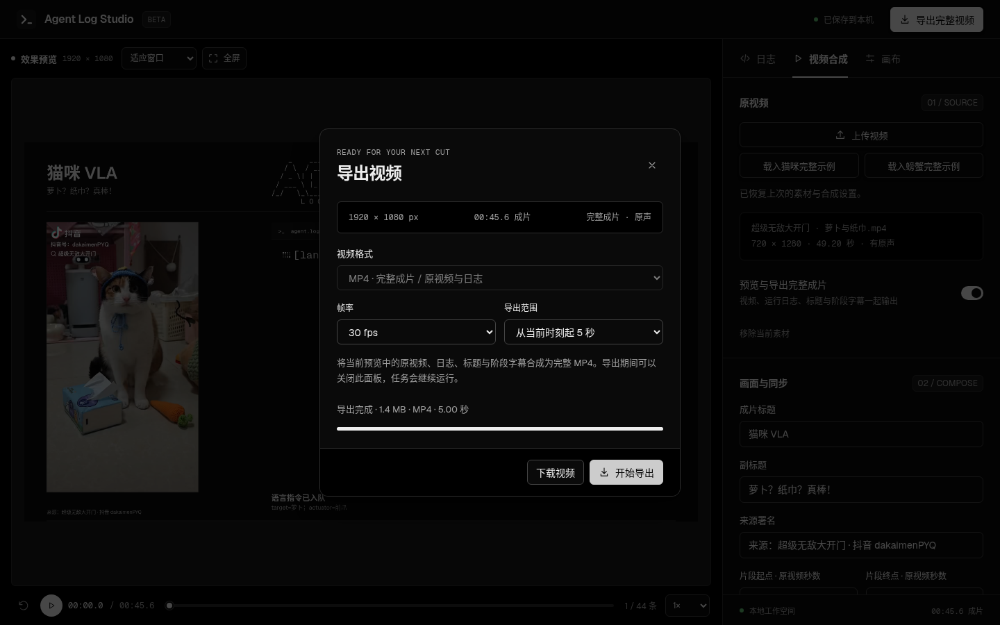](docs/images/web-export.png)

只需要日志素材时，关闭「预览与导出完整成片」，再选择黑底 MP4 或透明 WebM / MOV 导出，供其他剪辑流程使用。

日志、画布设置、合成设置与阶段字幕自动保存到当前浏览器；素材存放在服务端 `output/media/`，刷新网页会恢复关联。切换日志示例会替换当前日志；载入完整视频示例会替换日志、合成设置和素材，请先下载要保留的 CSV。CSV 不包含画布设置或阶段字幕。日志文案由用户编写或导入。

## CSV

```csv
id,scene,level,parent,timestamp,time,en,zh,shot,type
task-1,demo,thinking,,09:00:00,0,Planning the task.,正在规划任务。,,think
task-2,demo,action,task-1,09:00:01,1,Read the input.,读取输入。,,action
```

| 字段 | 含义 |
| --- | --- |
| `level` | `thinking` 主行、`action` 明细；控制字号与缩进。也支持 `1` / `2`、`思考` / `行动` |
| `type` | 可选：`think`、`feed`、`action`、`instruction` 控制配色；其他英文类型保留并以中性色显示 |
| `en` / `zh` | 英文与中文，至少一种非空；显示语言缺失时使用另一种 |
| `time` | 从片头开始的出现秒数，可为小数；同一场景按时间递增，允许相同 |
| `timestamp` | 上屏时间戳；没有 `time` 时可从 `HH:MM:SS` 推算相对时间，支持跨午夜 |
| `id` / `scene` | 可选：唯一行 ID 和场景标识 |
| `parent` | 可选：明细所属的前一个段落主行；带 `type` 的行可留空成为独立事件 |
| `shot` | 可选：镜头或外部对照标记，仅保留、不上屏 |

无 `type` 的双层 CSV 仍可导入，明细自动归入前一个主行。支持 UTF-8 BOM、CRLF、逗号、引号及带引号的多行文案。每次最多 2000 条日志；文件上传上限 8 MB。

## 视频导出

| 导出内容 | 格式 | 画面与音频 | 用途 |
| --- | --- | --- | --- |
| 完整成片 | MP4 / H.264 | 原视频、Geist 深色外框、日志与阶段字幕；可保留原声 | 网页直接完成并下载示例或自己的视频 |
| 纯日志 | MP4 / H.264（默认） | 黑底日志，无原视频或音轨 | 日常展示、黑底视频素材 |
| 纯日志 | WebM / VP9 | Alpha 透明日志 | 支持透明视频的浏览器或剪辑流程 |
| 纯日志 | MOV / ProRes 4444 | Alpha 透明日志 | 剪辑素材，体积较大 |

默认 60 fps，也支持 24 / 30 fps；载入猫咪或螃蟹完整示例时预设为 30 fps。导出使用 Chrome 逐帧渲染与 FFmpeg 编码，结果保存在 `output/exports/`；可查看进度、取消和下载。预览与导出共用同一 Canvas 渲染器。

开启完整成片时使用 MP4，包含原视频、Geist 界面、日志与阶段字幕，可保留原声。1× 播放倍率下，已是 AAC 的原声音轨直接复制；其他音频格式会转换为 AAC，倍速音频按同一倍率处理。上传的素材会准备为浏览器可播放的 H.264 预览文件，HEVC 等输入也能进入同一流程。

完整成片时长为（视频片段终点 − 起点）÷ 播放倍率；纯日志时长为（最后一条出现秒数 + 片尾停留）÷ 播放倍率。完整成片以选定的视频片段为准，超出片段的日志或阶段字幕不会延长视频。

单次最多 20 分钟或 36000 帧；画布支持 320–3840 × 240–2160，宽高必须为偶数。透明 MOV 沿用既有编码流程，部分 macOS 播放器的兼容问题尚未解决，需要在目标剪辑软件中确认。

## 开发

```sh
npm test
npm run build
# 先启动服务，再运行浏览器检查
npm run verify:playback
npm run verify:ui
npm run verify:composition
npm run verify:examples
```

浏览器检查默认连接 `http://127.0.0.1:4320`；可用 `AGENT_LOG_STUDIO_TEST_URL` 指定地址。`verify:ui` 验证纯日志导出；`verify:composition` 实际操作素材上传、裁切、字幕编辑、草稿恢复、原声／静音／倍速导出与取消，并用系统 `ffprobe` 核对帧数和音轨；`verify:examples` 验证所有完整视频预设的载入、播放、渲染一致性、网页导出及手机布局。测试产物写入 `output/qa/`。

| 位置 | 职责 |
| --- | --- |
| `src/config.js` | 应用名称、端口、存储命名 |
| `src/theme.js` | Geist 颜色、字体、材质变量与共享字体加载 |
| `src/samples.js`、`public/samples/` | 通用示例清单与 CSV |
| `src/model.js` | CSV、时间、层级、默认设置和校验 |
| `src/render.js` | 共用 Canvas 渲染与动画 |
| `src/composition.js`、`src/cat-vla.js`、`src/crab-vla.js` | 共享成片版式、合成校验与猫咪／螃蟹时间线 |
| `src/video-examples.js` | 完整视频示例的固定素材、日志、画布与字幕预设；网页与命令行共用 |
| `src/main.js`、`src/style.css` | 编辑器、预览和交互 |
| `server.mjs`、`export.html` | 本地服务、逐帧渲染、编码与下载 |
| `server/media.mjs` | 视频上传、浏览器预览准备、示例下载与范围读取 |
| `tests/`、`scripts/verify-*.mjs` | 模型测试、播放和界面验证 |

添加内置日志示例时，在 `public/samples/` 放入 CSV，然后更新 `src/samples.js`。完整视频示例还需要在 `src/video-examples.js` 登记固定素材 URL、SHA-256、署名、画布设置与合成时间线，网页会自动生成相应的载入入口。命令行可用 `node scripts/make-video-example.mjs <示例 ID>` 复现同一成片；首次下载通过校验后，会把原素材缓存在 `output/examples/<示例 ID>/`（猫咪为 `source.mp4`，螃蟹为 `source.ogv`），后续载入先校验并复用缓存。项目范围见 [项目说明](docs/项目说明.md)。
